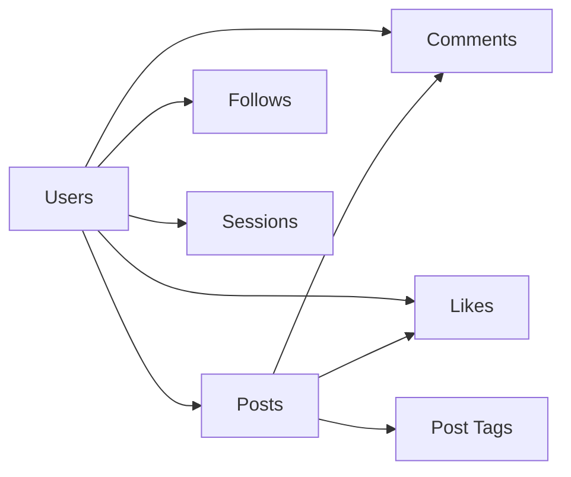

<div align="center">


<br/>

<a href="https://share.google/30HJA3MdFtRMcmAgc"></a>
&nbsp;
<a href="https://share.google/30HJA3MdFtRMcmAgc"></a>
&nbsp;
<a href="https://share.google/30HJA3MdFtRMcmAgc"></a>

<br/><br/>


</div>

---

## 🌐 Introduction

**Social Media Database Management** is a database-oriented project for organizing the information behind modern social platforms. Social applications generate interconnected data: people create profiles, publish posts, follow accounts, exchange comments, react to content, and generate events that can support meaningful analytics. Managing these relationships requires a thoughtful data model, reliable queries, and clear operational practices.

This guide presents a practical approach to modeling, querying, maintaining, and scaling social media data. It covers the most important entities, common application workflows, indexing strategies, privacy considerations, and the difference between transactional records and analytical summaries.

Whether you are building a community application, exploring backend architecture, or learning database design, the examples below provide a useful foundation for social-data workflows.

> **Design principle:** Keep relationships explicit, preserve data integrity, and optimize queries using evidence from real workloads.


## 🧩 Platform Capabilities

<div align="center">
<table>
<tr>
<td width="33%" align="center"><h3>🪪 Identity Records</h3>Organize user profiles, account metadata, and unique identifiers.</td>
<td width="33%" align="center"><h3>🧵 Content Catalog</h3>Structure posts, captions, timestamps, and publication states.</td>
<td width="33%" align="center"><h3>🪢 Social Graph</h3>Represent follows, connections, and relationship changes.</td>
</tr>
<tr>
<td align="center"><h3>🫧 Engagement Data</h3>Track likes, reactions, comments, and interaction history.</td>
<td align="center"><h3>🧮 Query Insights</h3>Explore engagement totals, active users, and content trends.</td>
<td align="center"><h3>🧯 Data Reliability</h3>Apply constraints, access controls, backups, and retention policies.</td>
</tr>
</table>
</div>

---

## 🏗️ Data Architecture

A relational database is a strong starting point for many social applications. Core entities are stored in separate tables, and foreign keys preserve the connections between accounts, content, and interactions. This avoids duplicating profile information on every post or comment.



### Core entities

| Entity | Typical fields | Purpose |
|:--|:--|:--|
| `users` | `id`, `username`, `created_at` | Account identity |
| `profiles` | `user_id`, `display_name`, `bio` | Public-facing profile details |
| `posts` | `id`, `author_id`, `body`, `created_at` | Published content |
| `comments` | `id`, `post_id`, `author_id`, `body` | Discussions on posts |
| `likes` | `user_id`, `post_id`, `created_at` | Unique reactions |
| `follows` | `follower_id`, `followee_id`, `created_at` | Directed account relationships |
| `tags` | `id`, `name` | Reusable content labels |
| `post_tags` | `post_id`, `tag_id` | Many-to-many content classification |

### Modeling decisions that matter

- **One-to-one:** A profile belongs to one user.
- **One-to-many:** A user can author many posts; a post can have many comments.
- **Many-to-many:** Users can follow many users, and posts can contain many tags.
- **Uniqueness:** A user should not like the same post twice when likes are modeled as a single state.
- **Timestamps:** Store time consistently, preferably in UTC.
- **Deletion:** Decide whether records should be hard-deleted, soft-deleted, or anonymized according to product and legal requirements.

---

## 🛠️ Example PostgreSQL Schema

The following SQL is an illustrative schema for a small social application. Adapt names, data types, migrations, and constraints to the actual application.

```sql
CREATE TABLE users (
    id BIGINT GENERATED ALWAYS AS IDENTITY PRIMARY KEY,
    username VARCHAR(40) NOT NULL UNIQUE,
    created_at TIMESTAMPTZ NOT NULL DEFAULT NOW()
);

CREATE TABLE posts (
    id BIGINT GENERATED ALWAYS AS IDENTITY PRIMARY KEY,
    author_id BIGINT NOT NULL REFERENCES users(id),
    body TEXT NOT NULL,
    created_at TIMESTAMPTZ NOT NULL DEFAULT NOW()
);

CREATE TABLE comments (
    id BIGINT GENERATED ALWAYS AS IDENTITY PRIMARY KEY,
    post_id BIGINT NOT NULL REFERENCES posts(id) ON DELETE CASCADE,
    author_id BIGINT NOT NULL REFERENCES users(id),
    body TEXT NOT NULL,
    created_at TIMESTAMPTZ NOT NULL DEFAULT NOW()
);

CREATE TABLE likes (
    user_id BIGINT NOT NULL REFERENCES users(id) ON DELETE CASCADE,
    post_id BIGINT NOT NULL REFERENCES posts(id) ON DELETE CASCADE,
    created_at TIMESTAMPTZ NOT NULL DEFAULT NOW(),
    PRIMARY KEY (user_id, post_id)
);

CREATE TABLE follows (
    follower_id BIGINT NOT NULL REFERENCES users(id) ON DELETE CASCADE,
    followee_id BIGINT NOT NULL REFERENCES users(id) ON DELETE CASCADE,
    created_at TIMESTAMPTZ NOT NULL DEFAULT NOW(),
    PRIMARY KEY (follower_id, followee_id),
    CHECK (follower_id <> followee_id)
);
```

### Indexing common access patterns

```sql
CREATE INDEX idx_posts_author_created
    ON posts (author_id, created_at DESC);

CREATE INDEX idx_comments_post_created
    ON comments (post_id, created_at DESC);

CREATE INDEX idx_likes_post
    ON likes (post_id);

CREATE INDEX idx_follows_followee
    ON follows (followee_id);
```

Indexes accelerate selected reads but add storage and write overhead. Validate them with `EXPLAIN (ANALYZE, BUFFERS)` on representative workloads.

---

## 🔎 Practical Query Recipes

### Latest posts by an author

```sql
SELECT id, body, created_at
FROM posts
WHERE author_id = 42
ORDER BY created_at DESC, id DESC
LIMIT 20;
```

### Most-liked posts

```sql
SELECT p.id, p.author_id, COUNT(l.user_id) AS like_count
FROM posts AS p
LEFT JOIN likes AS l ON l.post_id = p.id
GROUP BY p.id, p.author_id
ORDER BY like_count DESC, p.id DESC
LIMIT 10;
```

### Follower counts

```sql
SELECT u.id, u.username, COUNT(f.follower_id) AS followers
FROM users AS u
LEFT JOIN follows AS f ON f.followee_id = u.id
GROUP BY u.id, u.username
ORDER BY followers DESC, u.id;
```

### Daily posting activity

```sql
SELECT DATE(created_at AT TIME ZONE 'UTC') AS post_day,
       COUNT(*) AS posts_created
FROM posts
GROUP BY post_day
ORDER BY post_day DESC;
```

**Tip:** For very large tables, keyset pagination can be more efficient than deep `OFFSET` pagination. Use a stable sort order and a cursor based on the last returned record.

---

## 🚀 Recommended Development Workflow

1. **Define product requirements.** List the actions your application must support: create a profile, publish content, follow accounts, and retrieve feeds.
2. **Draft an entity relationship diagram.** Identify primary keys, foreign keys, and cardinality before writing migrations.
3. **Create migrations.** Apply schema changes incrementally and keep them under version control.
4. **Seed representative test data.** Include empty profiles, high-activity accounts, and edge cases such as duplicate reactions.
5. **Implement repository queries.** Use parameterized SQL or a trusted ORM to prevent SQL injection.
6. **Add integrity tests.** Verify uniqueness constraints, foreign-key behavior, and transaction boundaries.
7. **Measure performance.** Inspect query plans, slow queries, and the effects of indexes.
8. **Prepare operations.** Define backups, restoration tests, monitoring, and retention procedures.

### Example repository layout

```text
social-media-database/
├── README.md
├── database/
│   ├── migrations/
│   ├── schema.sql
│   └── seed.sql
├── src/
│   ├── models/
│   ├── repositories/
│   └── services/
├── tests/
│   ├── test_constraints.py
│   └── test_queries.py
└── docs/
    ├── architecture.md
    └── operations.md
```

*This layout is a suggested organizational pattern, not a claim about the repository's current file tree.*

---

## 📈 Analytics and Reporting

Operational queries answer immediate questions: Who posted this content? Has the current user liked it? Which comments belong to a post? Analytical queries answer broader questions about growth, engagement, and usage.

| Metric | Basic calculation | Interpretation |
|:--|:--|:--|
| Daily active users | Distinct users with qualifying activity per day | Daily participation |
| Posts per day | Count of newly created posts | Content production |
| Engagement per post | Reactions and comments per post | Interaction volume |
| Follower growth | Net change in follower relationships | Audience movement |
| Comment rate | Comments divided by eligible post views | Conversation activity |
| Retention | Returning users within a defined cohort | Ongoing engagement |

Define each metric precisely. For example, an engagement rate based on impressions cannot be calculated reliably if the application does not store impressions.

For growing systems, consider separating analytics workloads from the transactional database through replicas, materialized views, scheduled aggregates, or a data warehouse.

---

## 🔐 Privacy, Security, and Governance

Social media data can contain personal information, private content, and relationship details. Database design should support access restrictions and responsible data lifecycle management from the beginning.

- Apply **least-privilege access** to database roles and application services.
- Use **parameterized queries** and validate inputs at application boundaries.
- Keep passwords as **strong salted hashes**, never plaintext.
- Encrypt connections and protect backups and secrets.
- Distinguish **public, private, and restricted** content in authorization checks.
- Log administrative actions without exposing sensitive message content unnecessarily.
- Document retention periods, deletion requests, and export procedures.
- Test backup restoration, not only backup creation.
- Monitor slow queries, connection pools, and storage growth.

### Transaction consistency

A social action can affect multiple records. Use transactions when the application needs related changes to succeed or fail together. Keep transactions short, handle retries carefully, and design idempotent operations where duplicate requests are possible.

---

## ⚙️ Performance and Scaling Notes

| Challenge | First-line approach | When to reconsider |
|:--|:--|:--|
| Slow feed queries | Composite indexes and keyset pagination | High read volume or complex ranking |
| Expensive like counts | Indexed joins or cached aggregates | Repeated counts on popular posts |
| Growing write traffic | Efficient transactions and connection pooling | Sustained database contention |
| Large historical tables | Retention and partitioning strategy | Long-term data growth |
| Heavy analytics | Read replicas or precomputed summaries | Analytical load affects production latency |
| Search across content | Appropriate full-text search indexes | Advanced relevance or cross-language needs |

Avoid introducing distributed infrastructure before measurements justify it. A well-indexed relational schema can support substantial workloads with less operational complexity.

---

## 🧪 Testing Checklist

- [ ] Usernames are unique and invalid references are rejected.
- [ ] Duplicate likes and follows are handled correctly.
- [ ] Users cannot follow themselves where the product forbids it.
- [ ] Deleted posts do not leave unintended orphan records.
- [ ] Pagination remains stable when new posts are inserted.
- [ ] Unauthorized users cannot access restricted content.
- [ ] Slow queries are profiled against realistic data sizes.
- [ ] Migrations are repeatable and rollback procedures are documented.
- [ ] Backup and recovery processes have been tested.

---

## ❓ Frequently Asked Questions

<details>
<summary><b>Which database should I use for a social platform?</b></summary>

PostgreSQL is a strong general-purpose choice for relational social data. Other databases may fit particular workloads, existing infrastructure, or operational constraints. Start from data relationships and access patterns.

</details>

<details>
<summary><b>Should posts and comments live in the same table?</b></summary>

Separate tables often make constraints and queries easier to understand. A unified content model may be appropriate for products with shared behavior, but it introduces additional modeling decisions.

</details>

<details>
<summary><b>How do I prevent duplicate likes?</b></summary>

Use a composite primary key or unique constraint on `(user_id, post_id)` and make the application handle constraint conflicts gracefully.

</details>

<details>
<summary><b>Do I need a graph database for followers?</b></summary>

Not necessarily. Relational tables handle ordinary follow relationships well. Specialized graph systems may be useful for advanced traversals or recommendation workloads, depending on scale and query complexity.

</details>

<details>
<summary><b>How should I store images and videos?</b></summary>

Store large media objects in an appropriate object storage service and keep metadata, ownership, and object references in the database. Enforce access controls consistently across both systems.

</details>

<details>
<summary><b>What is the best way to keep counts up to date?</b></summary>

Begin with accurate queries. If counts become expensive, consider cached counters or aggregate tables with clear consistency and reconciliation rules.

</details>

---

## 🧭 Further Reading

- [PostgreSQL Documentation](https://www.postgresql.org/docs/)
- [OWASP SQL Injection Prevention Cheat Sheet](https://cheatsheetseries.owasp.org/cheatsheets/SQL_Injection_Prevention_Cheat_Sheet.html)
- [OWASP Authorization Cheat Sheet](https://cheatsheetseries.owasp.org/cheatsheets/Authorization_Cheat_Sheet.html)
- [Database Normalization — Microsoft Learn](https://learn.microsoft.com/en-us/office/troubleshoot/access/database-normalization-description)

---

<div align="center">

### 🌱 Better data models build better social experiences

*Design thoughtfully · Query efficiently · Protect user data*


</div>
